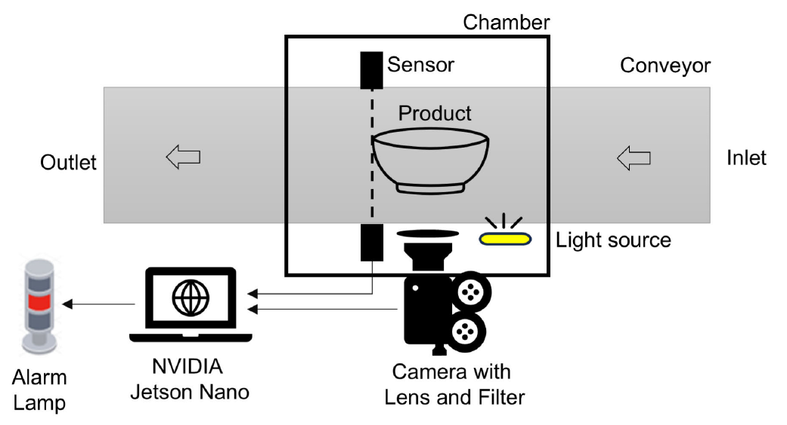
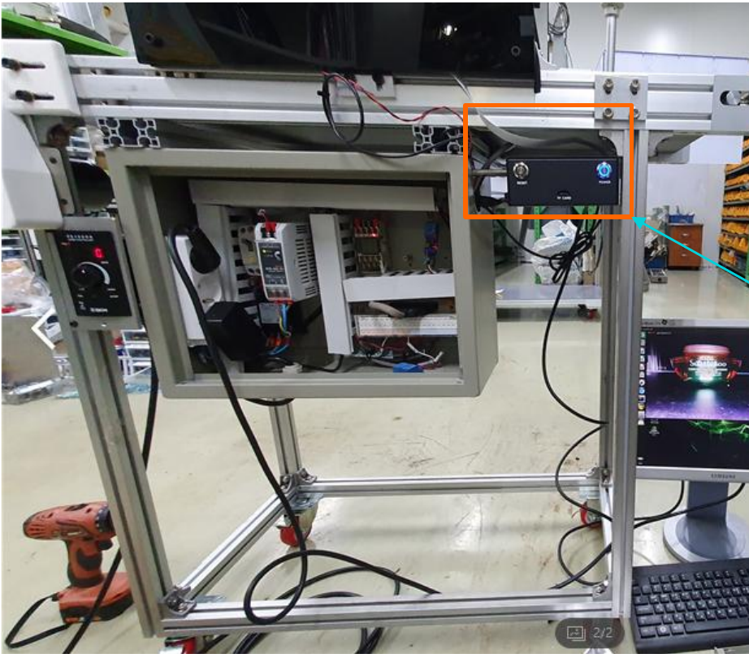
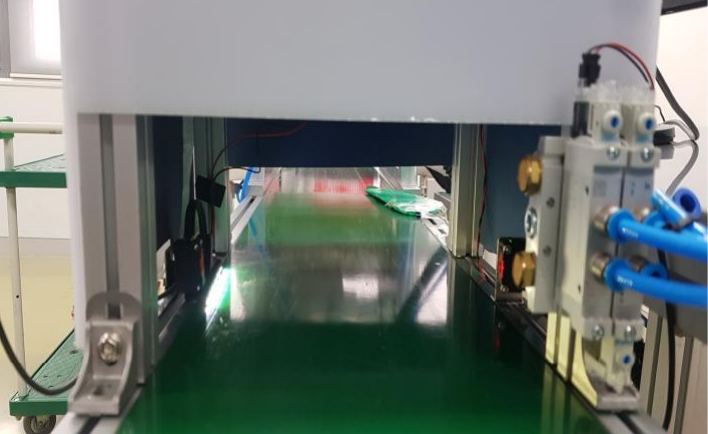
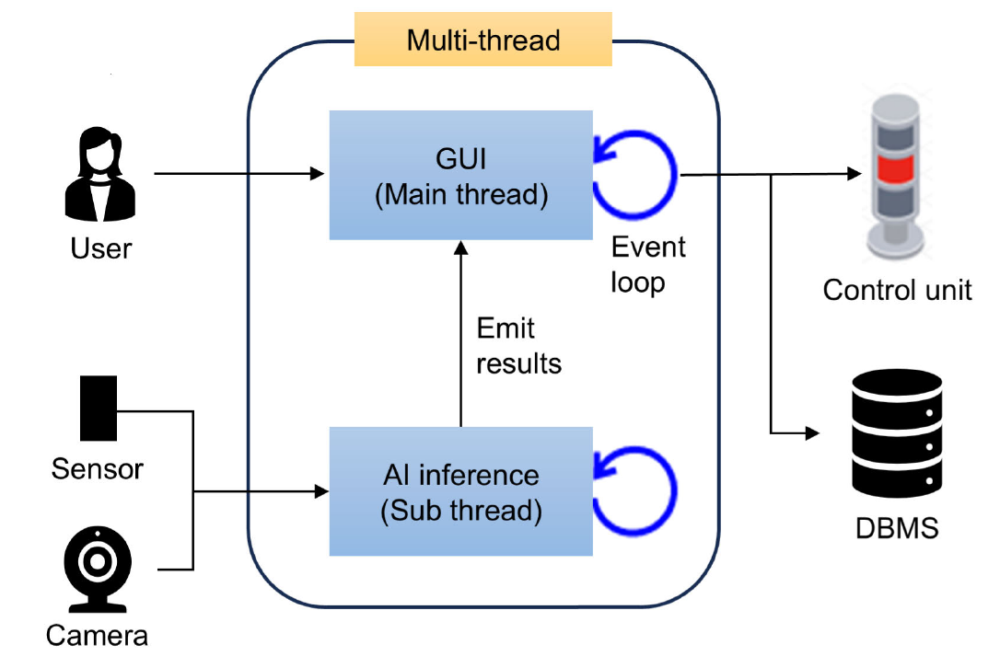
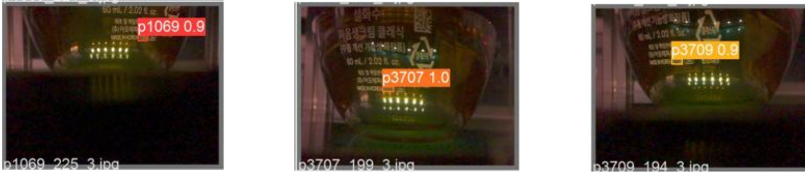
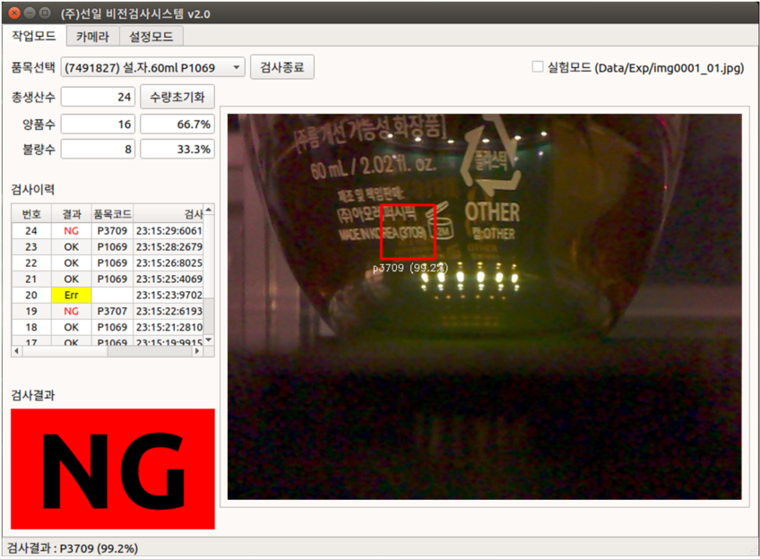
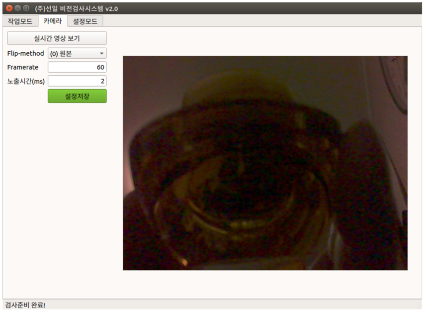
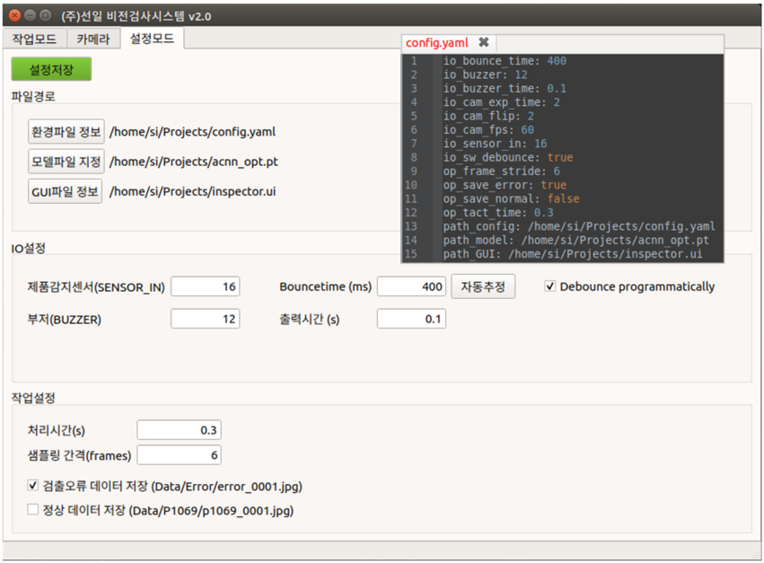

# AOI System: Deep Learning Vision Inspection on Jetson Nano

A low-cost automated optical inspection (AOI) system for a production line. It uses a YOLOv5 model on an NVIDIA Jetson Nano to check whether the correct product label is applied. The system was developed in 2022 by the Industrial AI Research Center, Chungbuk National University, together with SUNIL Co., Ltd.

> **Goal:** affordable deep learning vision inspection that runs on a Jetson Nano, so smaller manufacturers can use it ("AI for All").

## 📚 Overview

| Item | Target | Result |
|---|---|---|
| Function | Detect mixed-up product labels (classification / object detection) | ✅ |
| Speed | ≥ 2 items/s | ✅ Tact time ≤ 0.5 s |
| Accuracy | ≥ 99% | ✅ Precision/Recall 1.0, mAP@0.5 0.995 |
| Usability | Python + PyQt5 GUI program | ✅ |

## 🖥️ Hardware

 <b>System architecture</b>

<table>
  <tr>
    <td align="center" width="50%"></td>
    <td align="center" width="50%"></td>
  </tr>
  <tr>
    <td align="center"><b>Hardware setup</b></td>
    <td align="center"><b>Camera chamber</b></td>
  </tr>
</table>

Inside a black acrylic chamber, an LED light source and a camera with a lens and polarizing filter photograph each product as the conveyor carries it past. A photoelectric sensor triggers each inspection. The Jetson Nano runs the inference and turns on the alarm lamp when a product fails.

- **Conveyor:** an existing idle belt conveyor, modified for inspection
- **Camera chamber:** an enclosure that controls lighting
- **Controller:** Jetson Nano I/O interface and conveyor drive, housed separately from the Jetson Nano
- **Input:** one photoelectric sensor that detects products, and one CSI camera
- **Output:** one alarm relay (buzzer)
- **Processor:** NVIDIA Jetson Nano B01
  - CPU: quad-core ARM A57 @ 1.43 GHz
  - GPU: 128-core Maxwell
  - Memory: 4 GB

## 🧩 Software

**Stack:** JetPack (Ubuntu), Python, PyQt5 / Qt Designer, OpenCV with GStreamer, PyTorch, YOLOv5, Jetson.GPIO

| File | Role |
|---|---|
| `main.py` | Main program: GUI logic and the worker thread |
| `Camera.py` | CSI camera module using a GStreamer pipeline |
| `inspector.ui` | GUI layout made with Qt Designer |
| `config.yaml` | I/O pins, timing and file-path settings |
| `model.pt` | YOLOv5n detection model |

### Multithreaded architecture

The program runs two threads so that inference never freezes the GUI.

- **Main thread (`QMainWindow`):**
  - Runs the user interface and the settings.
  - Displays the results it receives from the worker thread through PyQt signals and slots.
- **Worker thread (`QThread`):**
  - Loads the YOLOv5 model onto the GPU once, at startup.
  - Waits for the rising edge of the photoelectric sensor.
  - Captures camera frames at a fixed stride and runs detection.
  - Sends the class, image and confidence back to the main thread with `pyqtSignal`.

### Version 2.0 improvements (over v1.0)

| Area | v1.0 | v2.0 |
|---|---|---|
| Code structure | A single script (about 280 lines) | Three modules: main, GUI (`.ui`) and camera |
| Model loading | Downloaded from the internet | Loaded from local disk |
| Inference | About 200 ms per image | **About 70 ms** per image, using a lighter model |
| Tact time | About 1 s | **Within 0.5 s** |
| Resources | Camera and I/O set up again for every inspection | Set up once at startup; released on exit |
| Clocks | Default | `jetson_clocks` at MAXN |
| Modes | Work mode only | Work, camera and settings modes |

## 📊 Results

**Detection model:** YOLOv5n trained on 1,200 labeled images (4 product classes × 300 images).

| Class | Precision | Recall | mAP@0.5 |
|---|---|---|---|
| all | 1.0 | 1.0 | 0.995 |

**GUI: work mode.** You select a product and start or stop the inspection. The screen shows the OK/NG result, the latest image, the running counts and the inspection history.

**GUI: camera mode.** You can preview the live camera feed and set the flip method, frame rate and exposure time.

**GUI: settings mode.** File paths, I/O pins and operation settings are saved to `config.yaml`.

## 🔭 Future Work

- **Signal I/O:** delegate inputs and outputs to a PLC, to deal with floating inputs, switch bounce and alarm timing.
- **Data loop:** store inspection results in a database and retrain the model on the collected data.

## 📂 Repository Structure

_Code will be added._

## 📄 Related Work

- [Attention-based CNN (A-CNN)](https://github.com/kimhy365/AttentionCNN): small-object classification for AOI, IEEE TIM 2025
- [Hybrid TensorRT–PyTorch inference](https://github.com/kimhy365/TensorRT-PyTorch): accelerating A-CNN on the Jetson Nano
